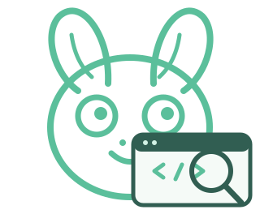
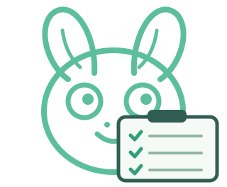

<div align="center">


# get-fable

### What if the coding agent you already use could work more like Claude Fable?

**Same model. Better working habits. A stronger coding loop.**

An open-source engineering harness for the coding agent you already use.

[](https://www.npmjs.com/package/get-fable)
[](docs/CANONICAL_SKILLS.md)
[](docs/HOSTS.md)
[](LICENSE)

[](https://github.com/imMamdouhaboammar/get-fable/actions/workflows/ci.yml)
[](https://github.com/imMamdouhaboammar/get-fable/actions/workflows/security.yml)
[](https://github.com/imMamdouhaboammar/get-fable/actions/workflows/e2e.yml)

<p>
  <a href="https://openai.com/codex"></a>&nbsp;&nbsp;
  <a href="https://www.anthropic.com/claude-code"></a>&nbsp;&nbsp;
  &nbsp;&nbsp;
  &nbsp;&nbsp;
  &nbsp;&nbsp;
  &nbsp;&nbsp;
  
</p>

<sub>Works across different agent environments. The integration depth depends on what each host can actually do.</sub>

**[Get started](#start-in-under-a-minute)** · **[See the working loop](#the-working-loop)** · **[Explore 46 Skills](#46-skills-eight-packs-one-lifecycle)** · **[Browse docs](#quick-destinations)**

</div>

---

## The problem starts after the agent says “Done.”

You ask an agent to fix a race condition. It finds the file, writes a patch, runs the tests, sees green, and makes one more change.

Then it says: **Done.**

Small problem: those green tests ran *before* the final edit. They don't prove the code you're about to ship.

You probably know the other versions of this story:

- The agent starts editing before understanding the repository.
- It remembers an SDK interface that changed two versions ago.
- It fixes a symptom without reproducing the original bug.
- It splits work between agents that quietly change the same contract.
- It retries the same failed theory with slightly different code.

I kept coming back to one question: **what if we changed the way an agent works, without replacing the model underneath?**

That's where get-fable started.

The model matters. Of course it does. But a good coding partner also needs habits: inspect first, research when facts are uncertain, prove the failure, make a bounded change, verify the final state, and stop when the evidence says the current approach is wrong.

get-fable puts those habits into a connected lifecycle of specialist Skills, state, routing decisions, and verification gates.

It won't turn a small model into a frontier model. It gives the model you already have a more disciplined way to approach software work.

<div align="center">


<sub>An illustrative route, not a fixed sequence. Research, recovery, security, and release take over when the task calls for them.</sub>

</div>

## The working loop

Take a real request:

> Fix the token refresh race condition, and show me it is fixed.

The useful next move is rarely “start changing the auth module.” The agent first has to find the real failure boundary.

| Question | get-fable route | What should come out of it |
| --- | --- | --- |
| Where does the refresh race actually happen? | `fable-discover` | A traced execution path, not a filename guess |
| Are current SDK semantics involved? | `fable-research` | Version-appropriate primary-source evidence |
| Can we make the bug fail for the right reason? | `fable-tdd` | A meaningful RED before the production change |
| What is the smallest repair? | `fable-execute` | One bounded edit that respects existing code |
| Does the final version still pass? | `fable-verify` | Fresh evidence after the last mutation |
| What might we have missed? | `fable-review` | A concrete, adversarial look at the diff |

Different request, different route. A broken hypothesis goes to `fable-recover`. A trust-boundary change calls for `fable-security`. A release needs proof of the actual artifact, not just a clean source tree.

**The lifecycle follows the state of the work.** It is not a checklist the agent blindly recites.

## This is more than a prompt pack

“Use TDD” and “verify your work” are useful instructions. They are also easy to say and easy to forget halfway through a long coding session.

get-fable adds specific decisions around them:

| A generic instruction | What the Fable workflow asks instead |
| --- | --- |
| *Check your work.* | Did the code change since the last passing evidence? |
| *Write a failing test.* | Did RED fail because of the bug, or because the fixture is broken? |
| *Use subagents.* | Are the tasks independent in files, contracts, and verification? |
| *Keep debugging.* | Has this hypothesis already failed? What probe would disprove the next one? |
| *Ship it.* | Did we test the same artifact the user will actually install? |

There are structured handoffs, state files, and tooling around these questions. How much an individual host can enforce depends on its hooks and permissions. Rule-only integrations remain advisory.

## Start in under a minute

Choose the entry point that fits your setup.

**Skills only:** add the playbooks to an agent that supports the Skills format.

```bash
npx skills add imMamdouhaboammar/get-fable
```

**CLI with Bun:**

```bash
bun add -g get-fable
```

**CLI with npm:**

```bash
npm install -g get-fable
```

Then configure a host, initialize your project, and route your first request:

```bash
get-fable install codex  # or: claude, antigravity, opencode, cursor...
cd your-project
get-fable init
get-fable doctor
get-fable route "Fix the token refresh race condition with a regression test"
```

Want to see the smallest useful next step while you're working?

```bash
get-fable spark
```

You can also run `get-fable install all` if you intentionally want to configure every supported host. For Homebrew, shell installation, DSH, and Claude Code Marketplace setup, see the [installation guide](docs/INSTALLATION.md).

## 46 Skills. Eight packs. One lifecycle.

<div align="center">



</div>

Each Skill has an activation boundary, decision rules, failure handling, evidence expectations, and references. A router chooses the next specialist from task intent *and* current state, including stale verification, unresolved unknowns, security concerns, and repeated failures.

| Pack | Skills | What it owns |
| --- | ---: | --- |
| **Core** | 7 | Discovery, planning, execution, verification, recovery, lifecycle routing |
| **Intelligence** | 1 | Current research against primary sources |
| **Build** | 4 | TDD, safe delegation, codebase fit, scope discipline |
| **Proof** | 10 | Testing, review, security, red teaming, evidence, anti-slop, anti-churn |
| **Delivery** | 5 | Release readiness, handoff, completion, repository maintenance |
| **Evolution** | 2 | Behavioral evaluation and durable learnings |
| **System** | 15 | Architecture, capabilities, context, simulation, artifacts, runtime workflows |
| **Creator** | 2 | Skill and domain-specific playbook authoring |

The catalog is intentionally broader than a single bug-fixing flow. For example:

- **`fable-spark`** can suggest one small next action, or say nothing when the current step is clear.
- **`fable-recover`** stops repeated blind patches and asks for a falsifiable diagnosis.
- **`fable-anti-slop-engineering`** looks for weakened assertions, swallowed errors, unsafe shortcuts, and test tampering.
- **`fable-architecture`** brings architecture constraints into the decision before a large scaffold is written.
- **`fable-release`** distinguishes code that looks ready from an artifact that has actually been checked.

See [all 46 canonical Skills](docs/CANONICAL_SKILLS.md) and their full contracts.

## A maintainer for the work between features

<div align="center">



</div>

Your repository has its own queue: CI breaks, pull requests wait, issues accumulate, and small problems compete with the next feature.

`get-fable steward` provides a five-tier triage loop:

1. Diagnose failing mainline CI.
2. Review pending pull requests.
3. Work through valid open issues.
4. Inspect code hygiene and anti-slop findings.
5. Consider a bounded roadmap task when higher-priority work is clear.

Start by inspecting what it *would* do:

```bash
get-fable steward --dry-run
```

Then run one cycle if you want it to act within your configured repository permissions:

```bash
get-fable steward
```

The loop is a maintenance tool, not a promise that every issue can be repaired or every PR safely merged without human judgment. [Read the lifecycle and release details](docs/USAGE.md).

## Bring your own agent

The goal is portability, with an honest distinction between deep integrations and lighter ones.

| Integration depth | Examples | What to expect |
| --- | --- | --- |
| **Lifecycle hooks + Skills** |  Claude Code ·  Gemini / Antigravity ·  Grok | Host-specific hooks, Skills and lifecycle rules |
| **Skills + rules / plugins** |  Codex ·  OpenCode · Cline · Devin | Skills and rules, subject to host support |
| **Advisory rules** |  Cursor ·  Copilot · Windsurf | Guidance without claiming lifecycle enforcement |
| **Dedicated plugin + UI** |  DeepSeek Harness | Cordis plugin and consumed web UI |

There are [32 documented host targets](docs/HOSTS.md). Check the [compatibility matrix](docs/COMPATIBILITY.md) before assuming a particular hook or feature is available in your editor.

## The machinery behind the habits

Under the Skills are project-local `.fable` state and evidence, a CLI, host adapters, and optional components for more involved setups:

- **Repository Steward:** triage for CI, PRs, issues, hygiene, and roadmap work.
- **Rust Jev engine and Frontier testing:** engine and test infrastructure for advanced workflows.
- **gRPC worker and TOON packets:** a transport and message contract for distributed setups.
- **DSH plugin:** the DeepSeek Harness integration and web interface.
- **Behavioral evaluation:** export blinded scenarios and score results from an independent provider.

One boundary matters here: `get-fable worker-serve` starts a **transport-only worker** by default. It returns `NOT_SERVING` without a configured executor. A message saying a task was completed does not, by itself, prove the task ran correctly.

[Architecture](docs/ARCHITECTURE.md) · [Plugin integration](docs/PLUGIN.md) · [Security model](SECURITY.md)

## Evidence over the victory lap

An earlier version recorded 115 passes across 115 blinded external-provider cases. That result is history, **not fresh proof of the current Deep Skill Playbooks V2**. Material changes require new independent evaluation; until then, affected maturity should remain `NOT_CHECKED`.

This is the part of the philosophy worth keeping: if code, Skills, or evaluation criteria change, old green results shouldn't quietly become evidence for the new version.

```bash
get-fable behavior-eval export --out /tmp/fable-requests.json
# Execute the blinded requests with an independent provider.
get-fable behavior-eval score /tmp/provider-responses.json \
  --out evals/results/agent-behavior-v1.json
get-fable behavior-eval status
```

[How behavioral evidence is scored](docs/BEHAVIOR_EVIDENCE.md)

## Quick destinations

| Looking for... | Go here |
| --- | --- |
| Install and configure your agent | [Installation guide](docs/INSTALLATION.md) |
| Commands you can actually run | [CLI usage](docs/USAGE.md) |
| Every Skill and its responsibilities | [Canonical Skills](docs/CANONICAL_SKILLS.md) |
| Host support and its limitations | [Hosts](docs/HOSTS.md) · [Compatibility](docs/COMPATIBILITY.md) |
| The internals | [Architecture](docs/ARCHITECTURE.md) · [Plugin distribution](docs/PLUGIN.md) |
| Evidence, trust, and releases | [Evaluation](docs/BEHAVIOR_EVIDENCE.md) · [Security](SECURITY.md) · [Release](docs/RELEASE.md) |
| Help shape the project | [Contributing](CONTRIBUTING.md) · [Issues](https://github.com/imMamdouhaboammar/get-fable/issues) · [Support](SUPPORT.md) |

---

<div align="center">

### Better models help. Better working habits matter too.

Start with the agent you already have.

```bash
npx skills add imMamdouhaboammar/get-fable
```

**[Get started](docs/INSTALLATION.md)** · **[See the Skills](docs/CANONICAL_SKILLS.md)** · **[Releases](https://github.com/imMamdouhaboammar/get-fable/releases)**

<sub>Independent open-source project · GNU AGPLv3 · Not affiliated with Anthropic or other agent vendors.</sub>

</div>
