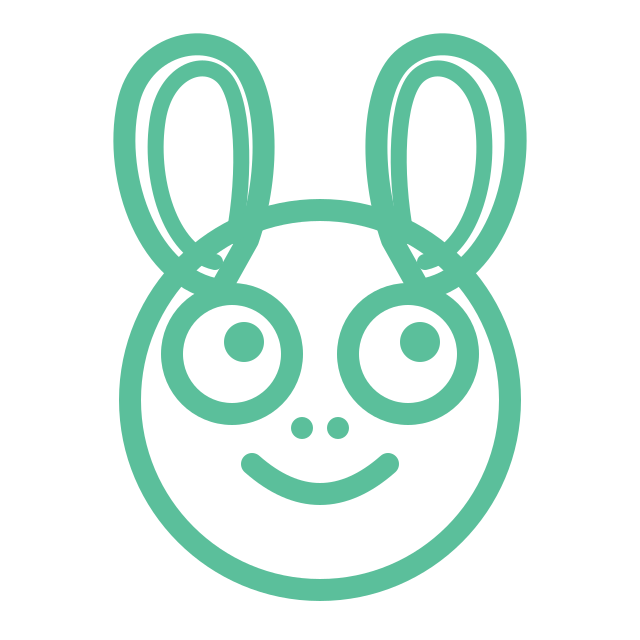

<div align="center">



# get-fable

### What if the coding agent you already use could work more like Claude Fable?

**Same model. Better working habits. A more accountable coding loop.**

<a href="https://www.npmjs.com/package/get-fable"></a>
<a href="./LICENSE"></a>

</div>

## Quick install

Add the open-source Skills to your coding agent or project:

```bash
npx skills add imMamdouhaboammar/get-fable
```

Install the CLI separately with your preferred package manager:

```bash
# Recommended: Bun 1.3+
bun add -g get-fable

# Alternative: npm (the CLI still requires Bun to run)
npm install -g get-fable
```

Or use the [shell installer](install.sh) after reviewing it:

```bash
curl -fsSL https://raw.githubusercontent.com/imMamdouhaboammar/get-fable/master/install.sh | sh
```

Then, from the root of your own project:

```bash
get-fable --version
get-fable init
get-fable install all
get-fable skills install all
get-fable doctor --json-v1
get-fable lint
```

`install all` targets supported coding hosts, while `skills install all` deploys the available Skills. Both can change local or global agent settings. Check what is installed and back up custom host configurations first. Run `init` only inside the project you intend to set up.

<div align="center">

**[Installation guide](docs/INSTALLATION.md) · [Agent setup playbook](docs/install-and-init-get-fable.md) · [Skill catalog](docs/CANONICAL_SKILLS.md)**

</div>

### Ask your agent to install and configure get-fable

Copy this into Codex, Claude Code, Cursor, Gemini CLI, or the coding agent you use:

```text
Set up the latest public get-fable release for this project.

Read and follow the install-and-init-get-fable onboarding playbook:
https://github.com/imMamdouhaboammar/get-fable/blob/master/docs/install-and-init-get-fable.md

1. Inspect the OS, repo root, available agent hosts, existing configurations,
   and Bun/Git/Python versions. Protect existing settings and uncommitted work.
2. Install or update the get-fable CLI via bun add -g get-fable, or use npm
   if Bun's package manager is not available. Verify the installed version.
3. Install the public Skills via npx skills add imMamdouhaboammar/get-fable.
4. In this project's root run get-fable init, then configure supported hosts
   using get-fable install all and Skills using get-fable skills install all.
5. Check get-fable status --json-v1, doctor --json-v1, and lint. Run a safe
   routing smoke test without changing application code.
6. Explain the daily workflow in my preferred language and provide a concise
   report of versions, installed hosts, Skills, checks, skipped steps, and fixes.

Before global toolchain changes, shell changes, git hook replacements, or
fable-eco capability provisioning, show the plan and request my consent.
Never overwrite custom configuration or handle credentials without approval.
Do not claim success unless the final checks actually pass.
```

[Full copy-ready agent prompt with acceptance criteria →](docs/AGENT_SETUP_PROMPT.md)

---

## The problem is not always the model

You ask an AI coding agent to fix a bug. It jumps into an edit, produces something plausible, runs a test, and declares victory. An hour later, you discover it tested the wrong thing, or changed more than the task needed, or forgot the original decision.

Maybe a stronger model would have avoided it. But some of these failures come from *how the work is organized*.

A useful engineering partner needs to know when to investigate, when to write a failing test, when to get the current API contract, and when to admit the evidence is not good enough yet.

That is the idea behind get-fable.

**It is a portable working method for the coding agent you already use.** The model still writes the code. The Skills and CLI help it make better decisions about the work around the code.

### A bug fix, with a little more discipline

| Without an explicit lifecycle | With get-fable |
| --- | --- |
| Start editing from a guess | Locate the real execution path first |
| Fix the apparent symptom | Reproduce the failure at a meaningful test boundary |
| Lose the plan across sessions | Keep work cards and decisions in `.fable/` |
| Repeat the same failed patch | Pause and revisit the diagnosis |
| Report a green test from before the last change | Collect fresh evidence against the current files |
| Announce completion on confidence | Check acceptance criteria before closing |

Get-fable does not guarantee correct code. It gives a coding agent a more explicit process, and gives you better places to check whether it followed that process.

## One workflow, several specialized Skills

The public source currently includes **41 installable community Skills across 8 packs**. The adapters cover **32 host targets**, with different integration levels depending on the platform. A rule file, an installed Skill, and a lifecycle hook are different levels of support; they are not interchangeable.

| Stage | What the agent should establish | Example public Skills |
| --- | --- | --- |
| Discover | What actually runs, and where? | `get-fable`, `fable-discover`, `fable-research` |
| Plan | What is in scope, and what proves success? | `fable-plan`, `fable-architecture` |
| Build | Can we show the gap before changing production code? | `fable-tdd`, `fable-execute` |
| Verify | What could still disprove the claim? | `fable-verify`, `fable-review`, `fable-security` |
| Recover | Why did the previous approach fail? | `fable-recover` |
| Deliver | Is the artifact ready, and can someone else resume? | `fable-release`, `fable-handoff` |

The core lifecycle is useful on its own. Extra packs support architecture, security, visualization, memory, and other specialized work. See the [public catalog](docs/CANONICAL_SKILLS.md) for what is included in this repository.

## Keep state outside the conversation

The CLI can initialize project-local tracking files:

```text
.fable/
  state.json      # lifecycle and evidence state
  LEDGER.md       # work cards and acceptance checks
  PROGRESS.md     # what changed and why
```

The exact files and host integration depend on the installed CLI version. A Skills-only setup works without requiring the CLI to be present, but it cannot provide CLI-backed state checks and hooks.

That distinction is intentional: you can start small, inspect the method, and add the runtime support when you need it.

## Works with the agent you already use

Get-fable has integration targets for Claude Code, Codex, Gemini/Antigravity, Cursor, OpenCode, Grok, and other tools. Support varies by host: some receive Skills, others rule files or lifecycle hooks. Use [`get-fable install all`](docs/HOSTS.md) for supported host setup, or select a host individually, for example `get-fable install codex`.

Run the CLI's doctor to inspect your actual environment. A listed target does not imply every feature works on every host.

## Community today. A deeper MCP harness in development.

<table>
<tr><th>Available now: Community / OSS Skills</th><th>In development: Get-Fable Pro MCP</th></tr>
<tr>
<td>Open-source Skills, readable playbooks, documented lifecycle, and an optional CLI package. Licensed under AGPL-3.0-or-later.</td>
<td>A planned premium MCP-based engineering harness with deeper agent and tool integration. No release date, specification, price, or performance claim is being made yet.</td>
</tr>
</table>

**The public Skills remain open source.** Pro MCP is a future product direction, not a requirement for using the community edition. We want to build a remarkably capable harness, but we'll judge it by demonstrable behavior when it is released.

## What it is, and what it is not

- It **is** an inspectable set of engineering Skills and a separately distributed CLI.
- It **does not** change a model's weights, grant capabilities its host does not have, or make verification automatic on every platform.
- It **does not** promise zero mistakes, zero hallucinations, perfect autonomy, or a passing CI run for your project.
- It **does** encourage evidence you can inspect: tests, logs, state, diffs, and clear reasons to stop or continue.

If you are using the npm CLI, check its package version independently of the public GitHub checkout. The source-only public repository is **not** a runnable replacement for the npm CLI distribution.

## Documentation

| Looking for... | Start here |
| --- | --- |
| Quick setup and prerequisites | [Installation](docs/INSTALLATION.md) |
| Complete guided onboarding | [Install and initialize](docs/install-and-init-get-fable.md) |
| Copy/paste agent instruction | [Agent setup prompt](docs/AGENT_SETUP_PROMPT.md) |
| Available community Skills | [Skill catalog](docs/CANONICAL_SKILLS.md) |
| Host-specific integration levels | [Host matrix](docs/HOSTS.md) |
| Day-to-day commands | [Usage](docs/USAGE.md) |
| Architecture and evidence | [Architecture](docs/ARCHITECTURE.md) · [Evidence](docs/EVIDENCE.md) |
| Contributing and responsible disclosure | [Contributing](CONTRIBUTING.md) · [Security](SECURITY.md) |

## Contributing

Issues, documentation corrections, tests, and contributions to public Skills are welcome. Please keep the [contribution guidelines](CONTRIBUTING.md) and [security policy](SECURITY.md) in mind. Internal engineering assets, credentials, private evaluations, and unpublished commercial material are not community distribution material.

**License:** [AGPL-3.0-or-later](LICENSE). get-fable is an independent community project and is not affiliated with Anthropic or Claude Fable.
