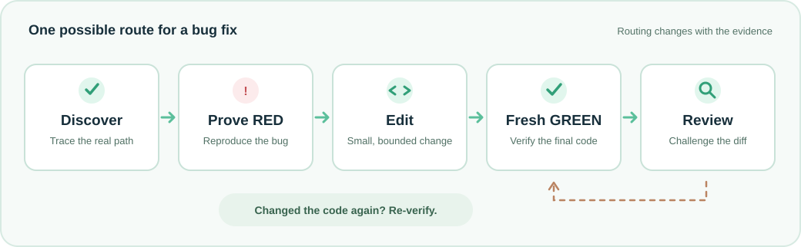

<div align="center">


# get-fable

### Your coding agent wrote the patch. Who checks the proof?

**Same agent. A clearer process from first question to verified result.**

An open-source engineering workflow built around Skills, routing, project state, and evidence.

[](https://www.npmjs.com/package/get-fable)
[](docs/CANONICAL_SKILLS.md)
[](docs/HOSTS.md)
[](LICENSE)

<p>
  <a href="https://openai.com/codex"></a>&nbsp;&nbsp;
  <a href="https://www.anthropic.com/claude-code"></a>&nbsp;&nbsp;
  &nbsp;&nbsp;
  &nbsp;&nbsp;
  &nbsp;&nbsp;
  &nbsp;&nbsp;
  
</p>

<sub>46 Skills in the public catalog · 32 documented host targets · No model replacement required</sub>

**[Install](#install-first-explore-next)** · **[The problem](#the-problem-starts-after-the-agent-says-done)** · **[Working loop](#the-working-loop)** · **[Skill catalog](#46-skills-eight-packs-one-lifecycle)** · **[Docs](#quick-destinations)**

</div>

---

## Install first. Explore next.

**Pick one starting point.** You can install the Skills without installing the CLI, or add the CLI when you want its local state and commands.

<table>
  <tr>
    <th align="left">01 · Just the Skills</th>
    <th align="left">02 · CLI + agent integration</th>
  </tr>
  <tr>
    <td>Bring the playbooks into a Skills-compatible agent. No new model and no background service.</td>
    <td>Use the <code>get-fable</code> commands for installation, project state, routing previews, and diagnostics.</td>
  </tr>
  <tr>
    <td><code>npx skills add imMamdouhaboammar/get-fable</code></td>
    <td><code>bun add -g get-fable</code><br/><sub>Or: <code>npm install -g get-fable</code></sub></td>
  </tr>
</table>

<details>
<summary><strong>Copy the Skills-only install command</strong></summary>

```bash
npx skills add imMamdouhaboammar/get-fable
```

The Skills installer lets you choose supported agents and installation scope. It installs playbooks; it does not start the get-fable CLI.

</details>

<details>
<summary><strong>Copy the CLI install commands (Bun or npm)</strong></summary>

```bash
# Bun
bun add -g get-fable

# Or npm
npm install -g get-fable
```

Installing the CLI and installing Skills are distinct paths. Run `get-fable doctor` to inspect the CLI/project setup, and use the Skills-only command above if your agent still needs its playbooks.

</details>

Once you have the CLI, the first run is deliberately inspectable:

```bash
get-fable install codex       # Or: claude, antigravity, opencode, cursor ...
cd your-project
get-fable init
get-fable doctor
get-fable route "Fix the token refresh race with a regression test"
```

<sub><code>route</code> shows the selected Skill and reasoning. It does <strong>not</strong> execute the request. Add <code>--apply</code> in an initialized project to save the routing decision. See the <a href="docs/INSTALLATION.md">full install guide</a> for other hosts and installation methods.</sub>

---

## The problem starts after the agent says “Done.”

You ask an agent to fix a race condition. It finds the file, writes a patch, runs the tests, sees green, and makes one more change.

Then it says: **Done.**

Small problem: those green tests ran *before* the final edit. They don't prove the code you're about to ship.

You probably know the other versions of this story:

- The agent starts editing before understanding the repository.
- It remembers an SDK interface that changed two versions ago.
- It fixes a symptom without reproducing the original bug.
- It splits work between agents that quietly change the same contract.
- It retries the same failed theory with slightly different code.

The question behind get-fable is simple: **what changes if the agent has to account for what it knows, what it changed, and what it actually proved?**

That's where get-fable started.

The model matters. Of course it does. But a good coding partner also needs habits: inspect first, research when facts are uncertain, prove the failure, make a bounded change, verify the final state, and stop when the evidence says the current approach is wrong.

get-fable describes those habits in connected specialist Skills. Its CLI provides task routing, a project-local state record, evidence commands, and diagnostic checks. Individual agent hosts decide how much of that process they can enforce.

It won't turn a small model into a frontier model. It gives the model you already have a more disciplined way to approach software work.

<div align="center">



<sub>An illustrative route, not a fixed sequence. Research, recovery, security, and release take over when the task calls for them.</sub>

</div>

## The working loop

Take a real request:

> Fix the token refresh race condition, and show me it is fixed.

The useful next move is rarely “start changing the auth module.” The agent first has to find the real failure boundary.

| Question | get-fable route | What should come out of it |
| --- | --- | --- |
| Where does the refresh race actually happen? | `fable-discover` | A traced execution path, not a filename guess |
| Are current SDK semantics involved? | `fable-research` | Version-appropriate primary-source evidence |
| Can we make the bug fail for the right reason? | `fable-tdd` | A meaningful RED before the production change |
| What is the smallest repair? | `fable-execute` | One bounded edit that respects existing code |
| Does the final version still pass? | `fable-verify` | Fresh evidence after the last mutation |
| What might we have missed? | `fable-review` | A concrete, adversarial look at the diff |

Different request, different route. A broken hypothesis goes to `fable-recover`. A trust-boundary change calls for `fable-security`. A release needs proof of the actual artifact, not just a clean source tree.

**The lifecycle follows the state of the work.** It is not a checklist the agent blindly recites.

## A playbook is only useful if the next decision changes

“Use TDD” and “verify your work” are useful instructions. They are also easy to say and easy to forget halfway through a long coding session.

get-fable makes those questions explicit in its Skills and, where the CLI is configured, in the state and evidence workflow:

| A generic instruction | What the Fable workflow asks instead |
| --- | --- |
| *Check your work.* | Did the code change since the last passing evidence? |
| *Write a failing test.* | Did RED fail because of the bug, or because the fixture is broken? |
| *Use subagents.* | Are the tasks independent in files, contracts, and verification? |
| *Keep debugging.* | Has this hypothesis already failed? What probe would disprove the next one? |
| *Ship it.* | Did we test the same artifact the user will actually install? |

There are structured handoffs, state files, and tooling around these questions. With rule-only integrations, these are instructions for the agent to follow, not guarantees the host will enforce them.

The distinction is visible in the CLI. `get-fable route "<task>"` previews a specialist and required gates; `get-fable route "<task>" --apply` records that decision in an initialized project. Neither command runs the bug fix for you. The configured agent still has to carry out the task, and the evidence still has to be checked.

For a small, state-aware next-step suggestion, the separate `get-fable spark` command is available.

## 46 Skills. Eight packs. One lifecycle.

<div align="center">


</div>

The public catalog groups 46 Skills into eight packs. Each describes when it should activate, how to decide what comes next, and what evidence it expects. The CLI router also uses task intent and available project state, including stale verification, security signals, and repeated failures. A first-time route without saved state has less context.

| Pack | Skills | What it owns |
| --- | ---: | --- |
| **Core** | 7 | Discovery, planning, execution, verification, recovery, lifecycle routing |
| **Intelligence** | 1 | Current research against primary sources |
| **Build** | 4 | TDD, safe delegation, codebase fit, scope discipline |
| **Proof** | 10 | Testing, review, security, red teaming, evidence, anti-slop, anti-churn |
| **Delivery** | 5 | Release readiness, handoff, completion, repository maintenance |
| **Evolution** | 2 | Behavioral evaluation and durable learnings |
| **System** | 15 | Architecture, capabilities, context, simulation, artifacts, runtime workflows |
| **Creator** | 2 | Skill and domain-specific playbook authoring |

The catalog is intentionally broader than a single bug-fixing flow. For example:

- **`fable-spark`** can suggest one small next action, or say nothing when the current step is clear.
- **`fable-recover`** stops repeated blind patches and asks for a falsifiable diagnosis.
- **`fable-anti-slop-engineering`** looks for weakened assertions, swallowed errors, unsafe shortcuts, and test tampering.
- **`fable-architecture`** brings architecture constraints into the decision before a large scaffold is written.
- **`fable-release`** distinguishes code that looks ready from an artifact that has actually been checked.

See [all 46 canonical Skills](docs/CANONICAL_SKILLS.md) and their full contracts.

## A maintainer for the work between features

<div align="center">


</div>

Your repository has its own queue: CI breaks, pull requests wait, issues accumulate, and small problems compete with the next feature.

`get-fable steward` implements five tiers of repository triage and local work:

1. Gather diagnostics for failing mainline CI and write an incident record.
2. Inspect a pending PR and write an initial review artifact.
3. Triage an open issue into a reproduction and TDD work plan.
4. Run local hygiene checks and record the results.
5. Work on a backlog-driven capability task, which may write source files.

Start by inspecting what it *would* do:

```bash
get-fable steward --dry-run
```

Then start a single cycle if you want it to act within your configured repository permissions:

```bash
get-fable steward
```

The default is one cycle. Continuous mode is opt-in with `--loop`. In the inspected implementation, issue triage writes a plan rather than fixing the issue, and PR triage writes a review artifact rather than merging the PR. The CLI accepts `--allow-self-merge`, but its PR action executor does not currently perform a merge. Treat generated findings as leads to verify, and inspect any workspace changes. [Read the lifecycle details](docs/USAGE.md).

## Bring your own agent

The goal is portability, with an honest distinction between deep integrations and lighter ones.

| Integration depth | Examples | What to expect |
| --- | --- | --- |
| **Lifecycle hooks + Skills** |  Claude Code ·  Gemini / Antigravity ·  Grok | Host-specific hooks, Skills and lifecycle rules |
| **Skills + rules / plugins** |  Codex ·  OpenCode · Cline · Devin | Skills and rules, subject to host support |
| **Advisory rules** |  Cursor ·  Copilot · Windsurf | Guidance without claiming lifecycle enforcement |
| **Dedicated plugin + UI** |  DeepSeek Harness | Cordis plugin and consumed web UI |

There are [32 documented host targets](docs/HOSTS.md), not 32 identical integrations. Check the [compatibility notes](docs/COMPATIBILITY.md) before assuming a particular hook or feature is available in your editor.

## The machinery behind the habits

Beyond the Skills, the core CLI includes project-local `.fable` state and evidence records, host adapters, and optional components for more involved setups:

- **Repository Steward:** triage for CI, PRs, issues, hygiene, and roadmap work.
- **Jev integration and Frontier testing:** optional routing and testing paths with their own configuration and readiness boundaries.
- **gRPC worker and TOON packets:** a transport and message contract for distributed setups.
- **DSH plugin:** a separately configured DeepSeek Harness integration.
- **Behavioral evaluation:** export blinded scenarios and score results from an independent provider.

One boundary matters here: `get-fable worker-serve` starts a **transport-only worker** by default. It returns `NOT_SERVING` without a configured executor. A message saying a task was completed does not, by itself, prove the task ran correctly.

[Architecture](docs/ARCHITECTURE.md) · [Plugin integration](docs/PLUGIN.md) · [Trust and security](docs/architecture/trust-and-security-model.md)

## Evidence over the victory lap

Past agent-behavior results are **not fresh proof of the current Deep Skill Playbooks V2**. The evaluation guide explicitly advises against hard-coding a request count because the corpus changes. Material changes need a new independent run; until then, affected maturity should remain `NOT_CHECKED`.

This is the part of the philosophy worth keeping: if code, Skills, or evaluation criteria change, old green results shouldn't quietly become evidence for the new version.

```bash
get-fable behavior-eval export --out /tmp/fable-requests.json
# Execute the blinded requests with an independent provider.
get-fable behavior-eval score /tmp/provider-responses.json \
  --out evals/results/agent-behavior-v1.json
get-fable behavior-eval status
```

[How behavioral evidence is scored](docs/BEHAVIOR_EVIDENCE.md)

## Quick destinations

| Looking for... | Go here |
| --- | --- |
| Install and configure your agent | [Installation guide](docs/INSTALLATION.md) |
| Commands you can actually run | [CLI usage](docs/USAGE.md) |
| Every Skill and its responsibilities | [Canonical Skills](docs/CANONICAL_SKILLS.md) |
| Host support and its limitations | [Hosts](docs/HOSTS.md) · [Compatibility](docs/COMPATIBILITY.md) |
| The internals | [Architecture](docs/ARCHITECTURE.md) · [Plugin distribution](docs/PLUGIN.md) |
| Evidence, trust, and releases | [Evaluation](docs/BEHAVIOR_EVIDENCE.md) · [Security model](docs/architecture/trust-and-security-model.md) · [Release](docs/RELEASE.md) |
| Help shape the project | [Issues and ideas](https://github.com/imMamdouhaboammar/get-fable/issues) · [Roadmap](ROADMAP.md) |

---

<div align="center">

### Better models help. Better working habits matter too.

Start with the agent you already have. Give it a process that asks for evidence after the last change.

**[Install](#install-first-explore-next)** · **[See the Skills](docs/CANONICAL_SKILLS.md)** · **[Releases](https://github.com/imMamdouhaboammar/get-fable/releases)**

<sub>Independent open-source project · GNU AGPLv3 · Not affiliated with Anthropic or other agent vendors.</sub>

</div>
