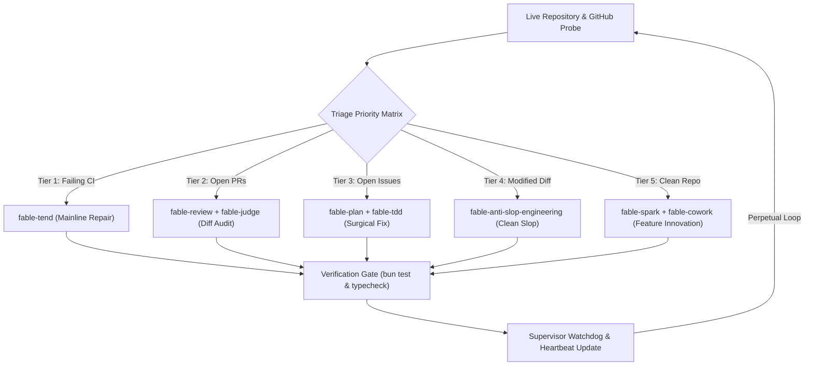

# Autonomous Perpetual Repository Steward

Autonomous repository triage, continuous maintenance, CI healing, PR verification, and capability packaging engine for `get-fable`.



## CLI Reference

```bash
# Probe live repository and GitHub platform status without mutating workspace
get-fable steward --dry-run

# Execute a single triage and action cycle
get-fable steward

# Run perpetual continuous stewardship loop with 60s cooldown between cycles
get-fable steward --loop --interval 60 --max-cycles 100

# Run unattended loop with automatic self-merging of passing PRs
get-fable steward --loop --interval 120 --allow-self-merge

# Output machine-readable JSON v1 envelope
get-fable steward --json-v1
```

### CLI Options

| Flag | Type | Default | Description |
|---|---|---|---|
| `--dry-run` | boolean | `false` | Probe state and print triage decision without writing files or mutating git |
| `--loop` | boolean | `false` | Run perpetual loop across multiple triage cycles |
| `--interval <sec>` | number | `60` | Cooldown interval in seconds between loop cycles |
| `--max-cycles <n>` | number | `100` (loop) | Maximum consecutive autonomous cycles before pausing |
| `--allow-self-merge`| boolean | `false` | Automatically merge pull requests when all status checks pass |
| `--no-watchdog` | boolean | `false` | Disable heartbeat telemetry and stall detection |
| `--json` | boolean | `false` | Emit compact raw JSON payload |
| `--json-v1` | boolean | `false` | Wrap output in standard schemaVersion: 1 envelope |

## Triage Priority Matrix

The triage engine evaluates repository signals deterministically in descending priority:

| Tier | Priority Target | Trigger Condition | Primary Skill | Action |
|---|---|---|---|---|
| **Tier 1** | Mainline CI Runs | Mainline workflow run conclusion is `failure` | `fable-tend` | Extract logs, reproduce failure locally, formulate minimal fix, verify build |
| **Tier 2** | Pull Requests | Non-draft PRs targeting default branch exist | `fable-review` + `fable-judge` | Audit diff against anti-slop rules, run adversary tests, submit structured review |
| **Tier 3** | Open Issues | Unassigned open GitHub issues exist | `fable-plan` + `fable-tdd` | Extract acceptance criteria, write failing reproduction test, apply native fix, open PR |
| **Tier 4** | Code Hygiene | Untracked or unstaged modifications present | `fable-anti-slop-engineering` | Scan for swallowed errors, weak assertions, leftover debug code, enforce clean git tree |
| **Tier 5** | Feature Innovation | Mainline green, zero open PRs/issues, clean tree | `fable-spark` + `fable-cowork` | Select next capability from roadmap backlog, execute with full unit/integration coverage |

## Supervisor Watchdog & Safety Invariants

The supervisor watchdog monitors loop execution to prevent runaway retries, infinite loops, and orphaned child processes.

```json
{
  "cycleIndex": 14,
  "lastHeartbeat": "2026-10-19T06:50:00.000Z",
  "status": "active",
  "failureStreak": 0,
  "circuitBreakerTripped": false,
  "activeTask": "Autonomous Feature Innovation: Tier 5"
}
```

### Invariants

1. **Failure Circuit Breaker**: Trips immediately when consecutive execution failures reach `failureStreak >= 2`. Execution pauses and alerts the supervisor rather than thrashing.
2. **Cycle Timeout**: Individual cycles are bounded to 60 seconds by default. A stalled subprocess is killed and logged as an incident before the next cycle starts.
3. **Heartbeat Persistence**: Heartbeat timestamps and cycle metrics are written to `.fable/watchdog-heartbeat.json` on every state transition.
4. **Non-Negotiable Merge Gate**: The steward never merges PRs into mainline unless `--allow-self-merge` is explicitly passed and CI checks are 100% green.
5. **Fresh Evidence Verification**: No work card is closed without passing `bun test` and `tsc --noEmit` evidence recorded under the current mutation generation.

## Lifecycle Recipes

| Recipe | File | Skills |
|---|---|---|
| `autonomous-repo-steward` | `recipes/autonomous-repo-steward.yaml` | `fable-discover`, `fable-tend`, `fable-review`, `fable-plan`, `fable-tdd`, `fable-execute`, `fable-anti-slop-engineering`, `fable-verify`, `fable-release` |
| `autonomous-ci-healer` | `recipes/autonomous-ci-healer.yaml` | `fable-tend`, `fable-review`, `fable-heal` |
| `autonomous-pr-reviewer` | `recipes/autonomous-pr-reviewer.yaml` | `fable-review`, `fable-anti-slop-engineering`, `fable-judge` |
