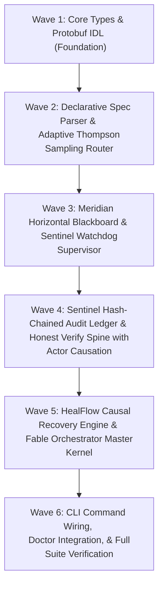

# Fable Orchestrator Agent Upgrade: Implementation Plan

- **Plan ID**: `PLAN-2026-10-19-ORCHESTRATOR-UPGRADE`
- **Specification**: [`docs/superpowers/specs/2026-10-19-orchestrator-agent-upgrade-design.md`](../specs/2026-10-19-orchestrator-agent-upgrade-design.md)
- **Status**: READY FOR IMPLEMENTATION
- **Target Branch**: `feature/upgrade-orchestrator-agent`
- **Target Version**: `1.15.0`
- **Execution Methodology**: Test-Driven Development (TDD) · Anti-Slop Engineering · Fable Lifecycle Rungs

---

## Task Breakdown & Execution Waves

---

### Wave 1: Core Types, Interfaces, & Protobuf IDL Contract

- [ ] **Task 1.1: Create Protobuf IDL Contract**
  - **File**: `proto/fable_orchestrator.proto`
  - **Details**: Declare gRPC service `FableOrchestrator` with RPCs: `SubmitTask`, `GetTaskStatus`, `StreamEvents`, `CancelTask`, `ProposeBlackboardArtifact`, `QueryBlackboard`.
  - **Verification**: `bun run build` / proto linting.

- [ ] **Task 1.2: Implement Core TypeScript Type Definitions**
  - **File**: `src/core/orchestrator/types.ts`
  - **Details**: Define TypeScript interfaces:
    - `OrchestratedTaskSpec`: metadata, goal, workspace strategy, budget, roles, acceptance predicates.
    - `BlackboardArtifact`: artifactId, taskId, workerId, artifactType, payload, timestamp.
    - `DecisionAuditRecord`: recordId, parentHash, timestamp, eventType, actorId, payload, recordHash.
    - `ExecutionTrace`: turnId, toolCalls, fileDiffs, exitCode, stdoutSignature.
    - `ActorCausationVerdict`: `CAUSAL_PASS`, `UNCAUSED_PASS`, `MUTATION_FAILED`, `BLOCKED`.
    - `HealDiagnosis`: rootCause, affectedComponents, smallestViableRepair, rollbackCheckpoint.
  - **Verification**: `bun run typecheck`.

---

### Wave 2: Declarative Spec Parser & Adaptive Thompson Sampling Router

- [ ] **Task 2.1: Write Tests for Declarative Task Spec Parser**
  - **File**: `test/orchestrator/task-spec.test.ts`
  - **Details**: Unit tests for parsing YAML/JSON task specs (`ax`-style), validating required fields, budget constraints, roles, and acceptance predicates.
  - **Verification**: `bun test test/orchestrator/task-spec.test.ts` (RED).

- [ ] **Task 2.2: Implement Declarative Task Spec Parser**
  - **File**: `src/core/orchestrator/task-spec.ts`
  - **Details**: Parse and validate YAML/JSON specifications into `OrchestratedTaskSpec` objects with strict schema enforcement.
  - **Verification**: `bun test test/orchestrator/task-spec.test.ts` (GREEN).

- [ ] **Task 2.3: Write Tests for Contextual Thompson Sampling Router**
  - **File**: `test/orchestrator/adaptive-router.test.ts`
  - **Details**: Unit tests verifying Beta distribution sampling, reward update on passing evidence, penalty update on failing evidence, and persistence to `.fable/router-bandit.json`.
  - **Verification**: `bun test test/orchestrator/adaptive-router.test.ts` (RED).

- [ ] **Task 2.4: Implement Contextual Thompson Sampling Router**
  - **File**: `src/core/orchestrator/adaptive-router.ts`
  - **Details**: Dynamic multi-armed bandit augmenting static regex scoring in `src/core/task-router.ts`.
  - **Verification**: `bun test test/orchestrator/adaptive-router.test.ts` (GREEN).

---

### Wave 3: Meridian Horizontal Blackboard & Sentinel Watchdog Supervisor

- [ ] **Task 3.1: Write Tests for Horizontal Blackboard**
  - **File**: `test/orchestrator/blackboard.test.ts`
  - **Details**: Test `propose`, `request`, `commit`, conflict detection on concurrent proposals, and TTL expiration.
  - **Verification**: `bun test test/orchestrator/blackboard.test.ts` (RED).

- [ ] **Task 3.2: Implement Horizontal Blackboard**
  - **File**: `src/core/orchestrator/blackboard.ts`
  - **Details**: Typed in-memory and persisted blackboard allowing workers in the same task wave to exchange intermediate artifacts without escalating to root.
  - **Verification**: `bun test test/orchestrator/blackboard.test.ts` (GREEN).

- [ ] **Task 3.3: Write Tests for Sentinel Watchdog**
  - **File**: `test/orchestrator/sentinel-watchdog.test.ts`
  - **Details**: Test process registration, heartbeat polling, detection of timed-out workers, SIGTERM/SIGKILL dispatch, and worktree cleanup.
  - **Verification**: `bun test test/orchestrator/sentinel-watchdog.test.ts` (RED).

- [ ] **Task 3.4: Implement Sentinel Watchdog**
  - **File**: `src/core/orchestrator/sentinel-watchdog.ts`
  - **Details**: Background supervisor guarding worker execution, preventing zombie processes and resource starvation.
  - **Verification**: `bun test test/orchestrator/sentinel-watchdog.test.ts` (GREEN).

---

### Wave 4: Sentinel Hash-Chained Audit Ledger & Honest Verify Spine

- [ ] **Task 4.1: Write Tests for Hash-Chained Audit Ledger**
  - **File**: `test/orchestrator/ledger.test.ts`
  - **Details**: Test SHA-256 hash chaining, verification of chain integrity (`verifyChain()`), divergence detection upon record tampering, and cassette capture.
  - **Verification**: `bun test test/orchestrator/ledger.test.ts` (RED).

- [ ] **Task 4.2: Implement Sentinel Audit Ledger**
  - **File**: `src/core/orchestrator/ledger.ts`
  - **Details**: Tamper-evident append-only ledger storing decision events in `.fable/audit-ledger.jsonl`.
  - **Verification**: `bun test test/orchestrator/ledger.test.ts` (GREEN).

- [ ] **Task 4.3: Write Tests for Honest Verify Spine & Actor Causation**
  - **File**: `test/orchestrator/verify-spine.test.ts`
  - **Details**: Test execution trace analysis: verify that passing predicates check git diff touch points, reject uncaused passes, and enforce generation stamps.
  - **Verification**: `bun test test/orchestrator/verify-spine.test.ts` (RED).

- [ ] **Task 4.4: Implement Honest Verify Spine**
  - **File**: `src/core/orchestrator/verify-spine.ts`
  - **Details**: Verifies execution traces byte-for-byte, matching `vector-os-nano`'s moat.
  - **Verification**: `bun test test/orchestrator/verify-spine.test.ts` (GREEN).

---

### Wave 5: HealFlow Causal Recovery & Fable Orchestrator Master Kernel

- [ ] **Task 5.1: Write Tests for HealFlow Engine**
  - **File**: `test/orchestrator/healflow.test.ts`
  - **Details**: Test failure diagnosis from error stacks, checkpoint creation, smallest-viable repair generation, and git rollback execution.
  - **Verification**: `bun test test/orchestrator/healflow.test.ts` (RED).

- [ ] **Task 5.2: Implement HealFlow Engine**
  - **File**: `src/core/orchestrator/healflow.ts`
  - **Details**: Model-agnostic self-healing runtime with compensating rollback actions.
  - **Verification**: `bun test test/orchestrator/healflow.test.ts` (GREEN).

- [ ] **Task 5.3: Write Tests for Fable Orchestrator Kernel**
  - **File**: `test/orchestrator/kernel.test.ts`
  - **Details**: End-to-end integration test: task submission, wave scheduling, 6-part contract delegation, blackboard artifact sharing, verification, and admission to `.fable/state.json`.
  - **Verification**: `bun test test/orchestrator/kernel.test.ts` (RED).

- [ ] **Task 5.4: Implement Fable Orchestrator Master Kernel**
  - **File**: `src/core/orchestrator/kernel.ts`
  - **Details**: Coordinates all subsystems into the unified Fable Maestro engine.
  - **Verification**: `bun test test/orchestrator/kernel.test.ts` (GREEN).

---

### Wave 6: CLI Integration, System Doctor, & Repository Verification

- [ ] **Task 6.1: Implement CLI Subcommands**
  - **File**: `src/cli/commands/orchestrator.ts` & wire into `src/cli.ts`
  - **Commands**:
    - `get-fable orchestrate <spec.yaml>`
    - `get-fable blackboard <status|query|propose>`
    - `get-fable sentinel <status|audit|replay>`
    - `get-fable heal <diagnose|rollback>`
  - **Verification**: `bun ./bin/get-fable.js orchestrate --help`.

- [ ] **Task 6.2: Add Doctor Check for Orchestrator Subsystems**
  - **File**: `src/core/doctor.ts`
  - **Details**: Add check `orchestrator-kernel` verifying availability of audit ledger, blackboard, watchdog, and verify spine.
  - **Verification**: `bun ./bin/get-fable.js doctor --json-v1`.

- [ ] **Task 6.3: Run Verification Gate**
  - Run in order:
    1. `bun run typecheck`
    2. `bun test`
    3. `bun run build`
    4. `bun ./bin/get-fable.js lint`
    5. `bun ./bin/get-fable.js doctor --json-v1`
  - Record fresh passing completion evidence:
    `bun ./bin/get-fable.js evidence pass test "bun test" "all orchestrator unit and integration tests pass"`
    `bun ./bin/get-fable.js evidence pass build "bun run build" "production build succeeds"`
