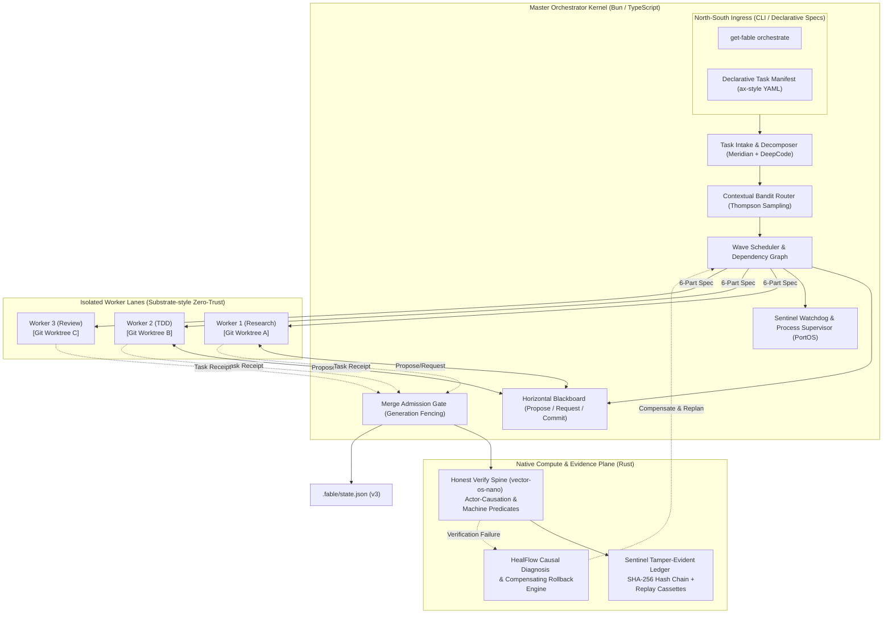

# Fable Orchestrator Agent Upgrade: Architectural Design Specification

- **Document ID**: `SPEC-2026-10-19-ORCHESTRATOR-UPGRADE`
- **Author**: Antigravity & Fable Architecture Team
- **Status**: APPROVED (Plan Phase)
- **Target Branch**: `feature/upgrade-orchestrator-agent`
- **Target Version**: `1.15.0`
- **Lifecycle Phase**: `planned`
- **Applicable Frameworks**: `/fable-architecture`, `/fable-wise`, `/using-superpowers`, `/rea`, `/anti-slop-engineering`, `/replica-architect`

---

## 1. Executive Summary & Vision

`get-fable` is the authoritative lifecycle control plane and front-door router for 44 canonical engineering skills. While the existing router (`src/core/task-router.ts`) provides static regex and keyword scoring, modern autonomous engineering workflows require a robust **Master Orchestration Agent (Boss Agent)** that operates as an industrial-grade agent operating system.

Inspired by 7 state-of-the-art agent operating systems, cluster schedulers, and multi-agent coordination architectures reverse-engineered via the REA protocol, this upgrade establishes the **Fable Maestro Orchestration Engine**. The system transitions `get-fable` from a static task-routing script into a resilient, self-healing, zero-trust, multi-agent operating system kernel.

---

## 2. REA Reverse-Engineering Evidence Ledger

Every design decision in this specification is grounded in verifiable primary-source code extracted from 7 reference repositories cloned into the isolated environment `/tmp/fable-orchestrator-research`:

| Target Repository | Verified Commit SHA | Key Architectural Primitives Extracted | Adaptation in Get-Fable |
|---|---|---|---|
| **VectorRobotics/vector-os-nano** | `cd7029aad15d6510c956f504e57181cbb6651996` | 1. **Kernel/World Seam**: Pure hardware-agnostic kernel with 4-seam contract (`CategorizedToolRegistry`, `GoalVerifier` predicate namespace, `GoalDecomposer` vocabulary, capabilities).<br>2. **Native Tool-Use Producer**: Model drives ReAct loop emitting synthetic `verify` and `finish` actions.<br>3. **Honest Verify Spine**: `trace_store`, `actor_causation`, `evidence_classifier`, `verdict` — rejects self-attestation byte-for-byte. | **Kernel Seam & Honest Verify Spine**: Clear separation between core lifecycle kernel and host environments; actor-causation tracking to ensure passing tests were directly caused by the agent's mutations. |
| **atomantic/PortOS** | `b0b2128d5b4c5c1df886a9a04b41c14da5b0bd5a` | 1. **Architect Doctrine**: Top-level agent emits specs, not code; delegated lanes share zero parent context.<br>2. **6-Part Spec Contract**: `WHAT`, `BOUNDARIES`, `ARTIFACTS`, `CONSTRAINTS`, `VERIFICATION`, `REASONING`.<br>3. **Sentinel Watcher**: Continuous background watchdog sweeping stalled agents and reclaiming zombie locks.<br>4. **Merge Admission Gate**: Prevents unverified changes from reaching trunk. | **Strict 6-Part Delegation & Watchdog**: Formal 6-part task cards for all subagents; background sentinel loop terminating zombie tasks and gating merge admission. |
| **ranadhir19/agentic-systems-lab** | `b504a1c734d5e5beeaf6dd49200b79f2a1fa0102` | 1. **Meridian Hierarchical Orchestration**: Vertical Meta-Orchestrator $\to$ Domain Orchestrators $\to$ Specialist Workers.<br>2. **Horizontal Peer Blackboard**: `propose / request / commit` protocol avoids vertical escalations.<br>3. **Thompson Sampling Bandit Optimizer**: Dynamic routing policy learning.<br>4. **Sentinel Ledger**: SHA-256 hash-chained append-only decision audit ledger with tool cassettes for deterministic replay.<br>5. **HealFlow**: Causal failure diagnosis, DAG pre/post-conditions, checkpoint states, smallest-viable repair, compensating rollback actions, persistent repair memory. | **Meridian Blackboard, Thompson Sampling, Sentinel Ledger, & HealFlow**: Horizontal blackboard coordination between subagents; contextual bandit router; hash-chained replay ledger; causal failure diagnosis and rollback. |
| **HKUDS/DeepCode** | `f183965f59a47cd1d437ee871a0d32b956dc9cdb` | 1. **Research-to-Code Pipeline**: Requirement analysis $\to$ Workspace synthesis $\to$ Architecture planning $\to$ Code generation $\to$ Verification.<br>2. **Planning Runtime & Plan Review Gate**: `run_plan_review_gate`, checkpoint callbacks, schema-enforced plan validation.<br>3. **Environment Isolation**: Sandboxed workspace preparation with process-level confinement. | **Plan Review Gate & Workspace Synthesis**: Interactive/automated plan review gate before execution; isolated worktree provisioning. |
| **VRSEN/agency-swarm** | `a86d657e12b693be64a8dcb8ead560a7b9a4ef01` | 1. **Directed Communication Flow Graph**: Explicit communication paths between agents (preventing chaotic all-to-all messaging).<br>2. **Agency Context & Thread Manager**: Shared agency state and session persistence.<br>3. **Central CEO Entry Point**: Single front-door conversational ingress coordinating worker agents. | **Communication Flow Matrix**: Explicit agent-to-agent communication graph preventing unconstrained lateral chatter. |
| **google/ax** | `8888435d7e275f1e7ad1c127af9048b2d97ebc13` | 1. **Declarative Task & Workspace CRDs**: Kubernetes-style declarative YAML (`Workspace`, `Task`, `Actor`).<br>2. **High-Throughput Task Orchestration**: Cluster-level scheduling, actor lifecycle, progress observation, debug attachment (`ax ssh`). | **Declarative Task & Workspace Specifications**: Standardized YAML/JSON task manifests with explicit git workspaces, goal declarations, and resource limits. |
| **agent-substrate/substrate** | `fd17a2fb16b8569c8a3d2a58345a5643d529dd02` | 1. **Zero-Trust Sandboxing**: gVisor (`runsc`) / MicroVM boundaries with isolated compute, network, storage.<br>2. **Zero Credentials in Sandbox**: Outbound requests routed through egress gateway PEP (`atenet-egress`) which injects secrets externally, preventing exfiltration.<br>3. **Cryptographic Identity**: Short-lived SPIFFE X.509 certs and per-actor JWTs.<br>4. **Stateful Actor Multiplexing**: Snapshot idle actors (<400ms resume) to run millions of agents at high density. | **Zero-Credential Child Sandboxing & Egress PEP**: Environment variable sanitization for subagents; token injection at proxy boundary; cryptographic actor identity tokens. |

---

## 3. Fable Architecture Inception 3-Vector Evaluation

In accordance with `/fable-architecture` (ADR 0007):

```text
Vector 1: Scale & Load
- Concurrency target: Multi-agent parallel task waves, worker process pools, concurrent tool calls.
- Score: 8 / 10

Vector 2: Domain Decoupling
- Operational boundaries: Task Ingress, Kernel Scheduler, Horizontal Blackboard, Worker Sandbox, Audit Ledger, Self-Healing Engine.
- Score: 9 / 10

Vector 3: Resource Intensity
- Heterogeneous workloads: I/O-intensive task routing (TypeScript/Bun), CPU-intensive cryptographic hashing, neural test execution, and diff verification (Rust native engine).
- Score: 8 / 10

Composite Architecture Score:
(0.35 * 8) + (0.40 * 9) + (0.25 * 8) = 2.8 + 3.6 + 2.0 = 8.4
```

### Architectural Verdict
- **Verdict**: `allowMonolith: false` (Threshold $\ge 6.0$ exceeded).
- **Enforcement**: Decoupled dual-plane architecture mandated.
- **Transport Standards**:
  - **North-South (External Ingress)**: CLI, REST HTTP/JSON (OpenAPI 3.1), Declarative YAML/JSON Task Manifests.
  - **East-West (Internal Services & Workers)**: gRPC with Protocol Buffers (`proto/fable_orchestrator.proto`) and TOON-serialized messaging. Prohibit un-typed internal JSON over HTTP.

---

## 4. Fable-Wise Cognitive Reflexes & Grounding

Applying `/fable-wise`:

1. **`re0` (Clean v0 Foundation)**:
   Avoid monkey-patching `src/core/task-router.ts` with hundreds of ad-hoc regexes. Establish clean v0 modules under `src/core/orchestrator/` with single-responsibility boundaries.
2. **`ssotize` (Single Source of Truth)**:
   All capability definitions derive from `skills/get-fable/registry.json`. All state derives from `.fable/state.json` (schema v3). All audit decisions stream to `.fable/audit-ledger.jsonl`. No duplicate state stores.
3. **`detool` (Language Primitives over Bloat)**:
   Use native Bun/Node standard library mechanisms, strict TypeScript types, and native Rust binaries (`crates/fable-orchestrator-core`) rather than pulling heavy, fragile third-party agent frameworks. Multi-agent serialization utilizes `@toon-format/toon` for 30–50% token economy.
4. **`hate` (Contrarian Stress Test)**:
   *The Fatal Flaw*: "Subagents communicating via a horizontal blackboard could suffer from split-brain state divergence, race conditions, or unverified silent commits."
   *The Invariant*: Subagents cannot write directly to `.fable/state.json`. The horizontal blackboard is restricted to ephemeral proposals. Every state mutation must pass through the Master Orchestrator's Merge Admission Gate with generation lock and fresh machine-checked verification evidence.
5. **`feynman` (Direct Reality Check)**:
   The orchestrator acts as a conductor:
   - Reads the task sheet (declarative spec).
   - Hands each musician their part (6-part contract).
   - Keeps them in time and in their lanes (dependency waves).
   - Listens with a strict acoustic tuner (honest verify spine).
   - Recovers smoothly if a note is missed (HealFlow causal recovery).

---

## 5. Architectural Blueprint: The Fable Maestro Engine



### Core Subsystems

### 5.1. Declarative Task & Workspace Specification (`google/ax` + `DeepCode`)
Tasks are expressed as declarative manifests supporting git worktree isolation, resource budgets, and explicit acceptance predicates:

```yaml
apiVersion: fable.io/v1alpha1
kind: OrchestratedTask
metadata:
  name: upgrade-auth-engine
spec:
  goal: "Migrate auth service to Argon2id and implement rate limiting"
  workspace:
    strategy: "worktree"
    baseRef: "HEAD"
  budget:
    maxTurns: 20
    maxCostUsd: 2.00
    timeoutSeconds: 600
  roles:
    architect:
      tier: "pro"
      skills: ["fable-plan", "fable-architecture"]
    implementer:
      tier: "standard"
      skills: ["fable-tdd", "fable-execute"]
    reviewer:
      tier: "standard"
      skills: ["fable-review", "fable-anti-slop-engineering"]
  acceptance:
    predicates:
      - command: "bun test test/auth.test.ts"
        mustPass: true
      - command: "bun run typecheck"
        mustPass: true
```

### 5.2. Meridian Hierarchical Decomposition & Horizontal Blackboard
- **Vertical Hierarchy**: Master Orchestrator $\to$ Domain Orchestrators $\to$ Specialist Workers.
- **Horizontal Blackboard**: Workers exchange intermediate artifacts (AST symbols, schema proposals, test fixtures) via a typed protocol:
  - `propose(artifact_id, type, payload)`: Publishes candidate artifact.
  - `request(type, filter)`: Queries available artifacts from peers.
  - `commit(artifact_id)`: Marks artifact accepted for merge admission.
  *Benefit*: Avoids round-tripping intermediate data through the top-level orchestrator, saving context and latency.

### 5.3. Adaptive Contextual Thompson Sampling Router
Augments get-fable's static 44-skill regex scoring with an online Bayesian multi-armed bandit:
- Tracks `success_count` and `failure_count` per (task_shape, skill_id) pair.
- Samples beta distribution $\text{Beta}(\alpha, \beta)$ during routing when confidence is borderline.
- Dynamically shifts routing preference toward skills that reliably produce passing evidence.

### 5.4. PortOS 6-Part Delegation Contract & Context Isolation
When delegating work, the Orchestrator emits **specs, not code**. Implementer lanes receive strictly:
1. `WHAT`: The concrete behavior to implement.
2. `BOUNDARIES`: Whitelisted files allowed to mutate; any edit outside is an invariant violation.
3. `ARTIFACTS`: Expected outputs, exports, types.
4. `CONSTRAINTS`: Anti-patterns, dependencies forbidden, performance limits.
5. `VERIFICATION`: Exact machine command that proves the unit is complete.
6. `REASONING`: Required cognitive effort level (e.g. `low`, `medium`, `high`, `ultra`).

### 5.5. Substrate Zero-Credential Sandboxing & Sentinel Watchdog
- **Credential Sanitization**: Child subagent processes run in clean subshells without ambient API keys or sensitive cloud tokens.
- **Egress Proxying**: Any external API calls pass through a local loopback proxy that injects authorization headers out-of-process.
- **Sentinel Watchdog**: Background supervisor running on a 5-second interval:
  - Heartbeat tracking for all running tasks.
  - Detection and SIGTERM/SIGKILL of zombie tasks exceeding timeout budgets.
  - Automatic worktree cleanup on worker crash or completion.

### 5.6. Vector-OS Honest Verify Spine & Actor-Causation
- **Actor-Causation Analysis**: Inspects git diff and file modification timestamps to prove that passing test results were caused by the current mutation generation, rather than pre-existing pass states.
- **Machine-Checked Predicates**: Reject self-attestation or natural language assertions. Completion strictly requires non-zero exit code verification with verifiable output signatures.

### 5.7. Sentinel Tamper-Evident Hash-Chained Audit Ledger
Every orchestration decision, worker dispatch, tool invocation, and evidence verdict is appended to `.fable/audit-ledger.jsonl`:
- Each record includes: `timestamp`, `parent_hash`, `event_type`, `payload`, `record_hash` ($\text{SHA-256}(\text{parent\_hash} + \text{payload})$).
- Includes deterministic tool cassette capture allowing bit-for-bit replay or exact divergence localization.

### 5.8. HealFlow Causal Diagnosis & Compensating Rollback
When a task fails repeatedly (`failureStreak >= 2`):
- Diagnoser analyzes error traces, AST blast radius, and git diff.
- Selects smallest viable repair:
  1. Patch implementation within existing lane.
  2. Compensating rollback of conflicting git commits.
  3. Re-route to alternative specialist.
- Persistent repair memory stores successful remediation patterns in `.fable/repair-memory.json`.

---

## 6. Protocols & Data Schemas

### 6.1. East-West Protobuf Contract (`proto/fable_orchestrator.proto`)

```protobuf
syntax = "proto3";

package fable.orchestrator.v1;

service FableOrchestrator {
  rpc SubmitTask (SubmitTaskRequest) returns (SubmitTaskResponse);
  rpc GetTaskStatus (TaskStatusRequest) returns (TaskStatusResponse);
  rpc StreamEvents (StreamEventsRequest) returns (stream OrchestratorEvent);
  rpc CancelTask (CancelTaskRequest) returns (CancelTaskResponse);
  rpc ProposeBlackboardArtifact (ProposeArtifactRequest) returns (ProposeArtifactResponse);
  rpc QueryBlackboard (QueryBlackboardRequest) returns (QueryBlackboardResponse);
}

message SubmitTaskRequest {
  string task_id = 1;
  string goal = 2;
  string declarative_spec_yaml = 3;
  map<string, string> context_variables = 4;
}

message SubmitTaskResponse {
  string task_id = 1;
  string status = 2;
  string assigned_orchestrator = 3;
}

message TaskStatusRequest {
  string task_id = 1;
}

message TaskStatusResponse {
  string task_id = 1;
  string phase = 2;
  uint32 mutation_generation = 3;
  uint32 verified_generation = 4;
  repeated string active_workers = 5;
  string latest_evidence = 6;
}

message StreamEventsRequest {
  string task_id = 1;
  string since_hash = 2;
}

message OrchestratorEvent {
  string event_id = 1;
  string parent_hash = 2;
  string timestamp = 3;
  string event_type = 4;
  string payload_toon = 5;
  string record_hash = 6;
}

message CancelTaskRequest {
  string task_id = 1;
  string reason = 2;
}

message CancelTaskResponse {
  bool success = 1;
  string message = 2;
}

message ProposeArtifactRequest {
  string task_id = 1;
  string worker_id = 2;
  string artifact_type = 3;
  string payload = 4;
}

message ProposeArtifactResponse {
  string artifact_id = 1;
  bool accepted = 2;
}

message QueryBlackboardRequest {
  string task_id = 1;
  string artifact_type = 2;
}

message QueryBlackboardResponse {
  repeated BlackboardArtifact artifacts = 1;
}

message BlackboardArtifact {
  string artifact_id = 1;
  string worker_id = 2;
  string artifact_type = 3;
  string payload = 4;
  string timestamp = 5;
}
```

### 6.2. TOON Delegation Contract Schema (`delegation-contract.toon`)

```toon
contract[6]:
  what: "Implement Argon2id password hashing in src/core/security/hasher.ts"
  boundaries:
    - "src/core/security/hasher.ts"
    - "test/security/hasher.test.ts"
  artifacts:
    - "hashPassword(password: string): Promise<string>"
    - "verifyPassword(password: string, hash: string): Promise<boolean>"
  constraints:
    - "Prohibit bcrypt or md5 imports"
    - "Execution time < 250ms for cost tier standard"
  verification: "bun test test/security/hasher.test.ts"
  reasoning: "high"
```

---

## 7. The Parts That Bite: Hard Edge Cases & Mitigations

1. **Late-Event Fencing**:
   *Risk*: A cancelled or timed-out worker returns an execution result or mutation after cancellation, corrupting state.
   *Mitigation*: Every worker invocation carries a monotonic `fencing_token`. The Merge Admission Gate drops any mutation whose token does not match the active schedule.
2. **Horizontal Blackboard Split-Brain**:
   *Risk*: Two concurrent subagents propose conflicting interfaces or schemas on the blackboard.
   *Mitigation*: Propose/Request is non-blocking, but Commit requires Master Orchestrator resolution. Conflicting writes automatically force serialization of subsequent execution waves.
3. **Prompt-Injection Secret Exfiltration**:
   *Risk*: An untrusted tool output instructs a subagent to dump `process.env` or read credentials.
   *Mitigation*: Subagent processes run with scrubbed environments (`PORTOS`/`SUBSTRATE` model). Credentials never enter child process memory; external network egress is intercepted and injected by the parent proxy.
4. **Stale Evidence Reuse**:
   *Risk*: A previous test run passed, and the orchestrator claims completion despite a subsequent mutation.
   *Mitigation*: Enforced invariant: $\text{verifiedGeneration} \ge \text{mutationGeneration}$. Every workspace edit advances `mutationGeneration`, invalidating all older proof.

---

## 8. CLI Interface Upgrades

```bash
# Declarative task execution
bun ./bin/get-fable.js orchestrate [task-spec.yaml] [--goal "text"] [--worktree]

# Blackboard inspection and peer coordination
bun ./bin/get-fable.js blackboard status [--task-id <id>]
bun ./bin/get-fable.js blackboard list-artifacts [--type <type>]

# Sentinel supervision and audit ledger
bun ./bin/get-fable.js sentinel status
bun ./bin/get-fable.js sentinel audit [--verify-chain]
bun ./bin/get-fable.js sentinel replay --decision-id <id>

# Self-healing and causal recovery
bun ./bin/get-fable.js heal diagnose [--task-id <id>]
bun ./bin/get-fable.js heal rollback --checkpoint <id>
```

---

## 9. Phased Implementation Roadmap

- **Phase 1: Foundation & Types (Vertical Slice 1)**:
  - Define core TypeScript types in `src/core/orchestrator/types.ts`.
  - Create `proto/fable_orchestrator.proto` IDL contract.
  - Implement Declarative Task Spec parser (`src/core/orchestrator/task-spec.ts`).
- **Phase 2: Master Kernel & Meridian Blackboard (Vertical Slice 2)**:
  - Implement `FableOrchestratorKernel` in `src/core/orchestrator/kernel.ts`.
  - Implement `HorizontalBlackboard` in `src/core/orchestrator/blackboard.ts`.
  - Implement Contextual Thompson Sampling Router in `src/core/orchestrator/adaptive-router.ts`.
- **Phase 3: Worker Isolation, 6-Part Contracts, & Sentinel Watchdog (Vertical Slice 3)**:
  - Implement `WorkerLaneSupervisor` with git worktree allocation and environment sanitization.
  - Implement `SentinelWatchdog` in `src/core/orchestrator/sentinel-watchdog.ts`.
  - Implement Merge Admission Gate with generation lock and fencing.
- **Phase 4: Native Compute Core: Audit Ledger, Verify Spine, & HealFlow (Vertical Slice 4)**:
  - Implement SHA-256 hash-chained `SentinelLedger` in `src/core/orchestrator/ledger.ts`.
  - Implement Honest Verify Spine with actor-causation tracking in `src/core/orchestrator/verify-spine.ts`.
  - Implement `HealFlowEngine` for causal failure diagnosis and compensating rollback.
- **Phase 5: CLI Integration, Full Verification, & System Doctor (Vertical Slice 5)**:
  - Wire CLI commands in `src/cli.ts` (`orchestrate`, `blackboard`, `sentinel`, `heal`).
  - Add comprehensive unit and integration test suite (`test/orchestrator/*.test.ts`).
  - Wire health checks into `src/core/doctor.ts`.
  - Record passing evidence and commit.
