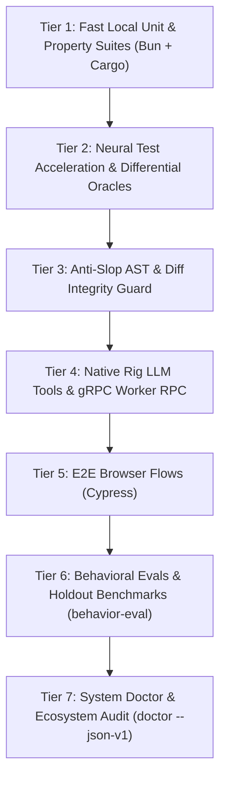

# fable-core-test

> **Orchestrate, execute, and diagnose the complete internal 7-tier test pyramid for get-fable crates, Bun suites, Cypress, and system doctor audit.**

- **Pack:** Proof Pack
- **Lifecycle Phase:** `verifying`
- **Mutates Workspace:** No
- **Parallel Safe:** Yes
- **Fallback Skill:** `fable-recover`

## Activation CLI Command

```bash
bun ./bin/get-fable.js route "test-crates" --apply
```

## Registered Intents
- `test-crates`
- `test-matrix`
- `neural-test`
- `doctor-audit`

## Required Gates
- `all-tiers-checked`
- `machine-checked`
- `no-skipped-tests`

## Next Allowed Skills
- `fable-verify`
- `fable-review`
- `fable-release`

---

# Fable Core Test: Internal 7-Tier Engine Pyramid & Diagnostic Engine

Orchestrate, execute, diagnose, and master the full 7-tier testing architecture of the `get-fable` engine.

---

## Mission

Maintain 100% platform health and cross-runtime parity across all native Rust crates and TypeScript modules within the `get-fable` repository. `fable-core-test` coordinates:
1. **TypeScript / Bun** unit and integration suites.
2. **Rust** native kernels and workspace crates (`fable-core`, `fable-cli`, `fable-anti-slop`, `fable-anti-churn`, `fable-neural-test`, `fable-rig`, `fable-eco`, `fable-toon`, `fable-jev`).
3. **Neural differential oracles** with SIMD tensor systolic arrays.
4. **Anti-slop AST inspection** preventing skipped tests and fake assertions.
5. **Cypress E2E browser flows** against bounded local servers.
6. **Agent behavioral evaluation holdouts** across canonical skills.
7. **System doctor ecosystem audits** ensuring 100% platform health.

---

## Activation Contract

### Activate When
- Maintainer requests executing get-fable's complete multi-tier test pyramid.
- Testing all workspace Rust crates (`cargo test --workspace`) and TypeScript test suites (`bun test`).
- Running differential neural oracles or auto-architecture tournaments on get-fable.
- Verifying cross-runtime parity across native bridges and gRPC worker services.

### Do Not Activate When
- Testing a consumer application or user project codebase -> use `fable-test`.
- Driving a single behavior change via red-green-refactor during implementation -> use `fable-tdd`.
- Performing the mandatory final gating check before session completion -> use `fable-verify`.

---

## Situation Classification

| Testing Context | Scope | Tiers Required |
|---|---|---|
| **TypeScript Change** | `src/` modules, router, state | Tier 1 (Bun test), Tier 3 (Anti-slop), Tier 7 (Doctor) |
| **Native Rust Kernel Change** | `crates/` engines, bridges | Tier 1 (Cargo test), Tier 2 (Differential), Tier 4 (Rig RPC) |
| **Documentation / Portal Change** | `site/`, HTML assets | Tier 5 (Cypress browser flows) |
| **Skill Prompt / Catalog Change** | `skills/`, prompts, catalogs | Tier 6 (Behavioral evals holdouts), Tier 7 (Doctor) |
| **Pre-Release Full Certification** | Complete engine room | Full 7-tier pyramid execution |

---

## Protocol



Execute tiers sequentially:
1. **Tier 1 (Unit & Property)**: `bun test` and `cargo test --workspace`.
2. **Tier 2 (Neural Differential)**: `get-fable rig call-tool fable_neural_test`.
3. **Tier 3 (Anti-Slop AST)**: `bun ./bin/get-fable.js anti-slop scan`.
4. **Tier 4 (Integration & RPC)**: `bun test test/rig-integration.test.ts test/worker-rpc.test.ts`.
5. **Tier 5 (Browser E2E)**: `bun run test:cypress`.
6. **Tier 6 (Behavioral Evals)**: `bun ./bin/get-fable.js behavior-eval status`.
7. **Tier 7 (System Doctor)**: `bun ./bin/get-fable.js doctor --json-v1`.

---

## Decision Rules

1. **If Cargo test fails**: Halt immediately; do not proceed to Tier 2 until native code compiles and passes tests.
2. **If anti-slop scan detects skipped tests**: Block release; no tests may be skipped to achieve green status.
3. **If behavioral evals show drift**: Check scenario diffs against canonical holdouts before updating prompt assets.

---

## Invariants

- **The Multi-Runtime Parity Invariant**: Native Rust and TypeScript dual-implementations must exhibit bit-exact or semantically identical outputs.
- **The Zero-Error Doctor Invariant**: `get-fable doctor` must report zero error-severity checks before any core release.
- **The Isolation Invariant**: Core maintainer tests must never leak into consumer project runs.

---

## Failure Taxonomy

| Failure Mode | Diagnosis Step | Resolution |
|---|---|---|
| **Crate Compilation Failure** | Check Rust toolchain & missing dependencies | Fix Cargo.toml dependencies or syntax errors in crates. |
| **Differential Drift** | Neural tensor output does not match oracle | Verify SIMD array alignment and precision thresholds. |
| **Doctor Check Failure** | Inspect host-parity or supply-chain check | Re-sync generated catalogs or repair missing platform links. |

---

## Anti-Patterns

| Anti-Pattern | Correct Practice |
|---|---|
| Running only `bun test` when Rust crates were edited | Always execute `cargo test --workspace` on native crate changes. |
| Bypassing Cypress tests on portal changes | Run headless Cypress checks against local HTTP servers. |
| Masking broken doctor checks with flags | Resolve underlying drift in catalog or manifest. |

---

## Completion Criteria

A core testing run is complete when:
- All 7 tiers have been evaluated or cleared for the target change.
- `cargo test --workspace` passes with zero failures.
- `bun test` passes with zero failures.
- `bun ./bin/get-fable.js doctor --json-v1` reports zero errors.

---

## Progressive Resources

- `references/test-pyramid-and-tiers.md`: Detailed breakdown of all 7 tiers.
- `references/anti-slop-and-diff-guard.md`: Anti-slop AST scanning specifications.
- `references/neural-test-and-differential-oracles.md`: Neural oracle architecture.
- `references/e2e-and-cypress-guide.md`: Cypress browser testing setup.
