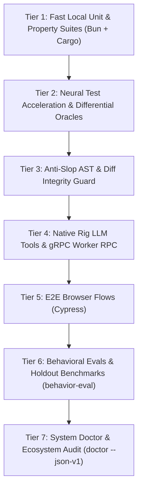

# Fable Test: End-to-End Test Pyramid & Diagnostic Engine

Orchestrate, execute, diagnose, and master the full 7-tier testing architecture of `get-fable`.

---

## Mission

Transform ad-hoc test running into an autonomous, rigorous, and deterministic test orchestration pipeline. `fable-test` spans all language runtimes in `get-fable`:
1. **TypeScript / Bun** unit and integration suites.
2. **Rust** native kernels and workspace crates (`fable-core`, `fable-cli`, `fable-anti-slop`, `fable-anti-churn`, `fable-neural-test`, `fable-rig`, `fable-eco`, `fable-toon`, `fable-jev`).
3. **Neural differential oracles** with SIMD tensor systolic arrays.
4. **Anti-slop AST inspection** preventing skipped tests and fake assertions.
5. **Cypress E2E browser flows** against bounded local servers.
6. **Agent behavioral evaluation holdouts** across 44 skills.
7. **System doctor ecosystem audits** ensuring 100% platform health.

---

## Activation Contract

### Activate When
- User requests executing the complete test suite or multi-tier test pyramid.
- User asks to test all crates or verify cross-runtime TypeScript and Rust parity.
- Agent needs to run neural test differential oracles or auto-architecture tournaments.
- Regression testing is needed across integration boundaries (Rig agent tools, gRPC East-West RPC).
- Running Cypress browser end-to-end workflows.
- Diagnosing flaky tests or triaging test suite failures across the repository.

### Do Not Activate When
- Driving a single behavior change via red-green-refactor during implementation -> use `fable-tdd`.
- Performing the mandatory final gating check before session completion -> use `fable-verify`.
- Performing penetration testing or security fuzzing against remote HTTP targets -> use `fable-redteam`.
- Reviewing git diffs for code smells or design issues -> use `fable-review`.

---

## The 7-Tier Test Pyramid



| Tier | Scope | Primary Command | Execution Target | Falsification Focus |
|---|---|---|---|---|
| **Tier 1** | Local Unit & Property | `bun test` & `cargo test --workspace` | TypeScript functions, Rust crates | Algorithmic logic, edge cases |
| **Tier 2** | Neural & Differential | `get-fable rig call-tool fable_neural_test` | Systolic array, bit-exact oracles | Tensor drift, non-deterministic output |
| **Tier 3** | Anti-Slop AST Guard | `bun ./bin/get-fable.js anti-slop scan` | Git diff, AST tokens | Swallowed errors, skipped tests, weak assertions |
| **Tier 4** | Rig Tools & gRPC | `bun test test/rig-integration.test.ts test/worker-rpc.test.ts` | Agent tools, proto East-West | Native bridge latency, RPC serialisation |
| **Tier 5** | Browser E2E | `bun run test:cypress` | Site, UI, dashboards | DOM interactions, navigation |
| **Tier 6** | Behavioral Evals | `bun ./bin/get-fable.js behavior-eval status` | 44 canonical skills, holdouts | Agent decision degradation, prompt drift |
| **Tier 7** | System Doctor | `bun ./bin/get-fable.js doctor --json-v1` | 32 hosts, supply chain, parity | Ecosystem inconsistency, drift |

---

## Decision Rules

1. **Strict Upward Execution Order:** Tiers must be executed from bottom to top (Tier 1 -> Tier 7). If Tier 1 fails, halt execution immediately; never run browser E2E (Tier 5) on broken unit logic.
2. **Fail-Closed on Anti-Slop Blockers:** If Tier 3 reports any blocker findings (such as `SKIPPED_TEST`, `WEAK_ASSERTION`, or `ERROR_SWALLOW`), the entire test run is marked FAILED regardless of passing unit tests.
3. **No Flaky Test Bypassing:** When a test intermittently fails, never mark it `.skip()` or add retry loops. Isolate the race condition or state leakage using Tier 2 differential replay.
4. **Native Binary Verification:** When testing Rig tools or native CLI commands, verify that `target/release/get-fable-native` exists and is up to date; do not silently test mock fallbacks.
5. **Fresh Evidence Stamping:** Record each passing tier into `.fable/state.json` using `bun ./bin/get-fable.js evidence pass test ...` after code modifications.

---

## Execution Protocol

### Stage 1: Discovery & Scope Mapping
1. Inspect the workspace for modified files (`git status`).
2. Identify changed layers (Rust crates, TypeScript core, RPC proto, UI/web).
3. Select the required test tiers based on changed surface risk.

### Stage 2: Unit & Native Kernel Execution (Tier 1)
1. Run TypeScript unit suite:
   ```bash
   bun test
   ```
2. Run Rust workspace test suite:
   ```bash
   ~/.cargo/bin/cargo test --workspace
   ```
3. Verify type correctness:
   ```bash
   bun run typecheck
   ```

### Stage 3: Neural & Anti-Slop Falsification (Tiers 2 & 3)
1. Execute bit-exact differential testing and provenance checks:
   ```bash
   ./target/release/get-fable-native rig call-tool --tool fable_neural_test --args '{"action":"ledger"}' --json
   ```
2. Run anti-slop AST diff guard across git changes:
   ```bash
   bun ./bin/get-fable.js anti-slop scan --base HEAD
   ```

### Stage 4: Integration, Rig Tools & gRPC (Tier 4)
1. Run native Rig agent tool tests:
   ```bash
   bun test test/rig-integration.test.ts
   ```
2. Run gRPC worker East-West communication tests:
   ```bash
   bun test test/worker-rpc.test.ts
   ```

### Stage 5: E2E Smoke, Behavioral Evals & Doctor (Tiers 5, 6, 7)
1. If frontend/web code was touched, run Cypress smoke:
   ```bash
   bun run test:cypress:smoke
   ```
2. Audit behavioral holdout maturity:
   ```bash
   bun ./bin/get-fable.js behavior-eval status
   ```
3. Run comprehensive doctor verification:
   ```bash
   bun ./bin/get-fable.js doctor --json-v1
   ```
4. Emit structured Test Run Report using `templates/test-run-report.template.md`.

---

## Failure Taxonomy

### `HARNESS_ENVIRONMENT_FAILURE`
- **Symptom:** Missing `cargo`, broken `bun` installation, missing binary in `target/release/`.
- **Diagnosis:** Check environment variables, `PATH`, and build binaries via `cargo build --release`.

### `TEST_INTEGRITY_VIOLATION`
- **Symptom:** Anti-slop scanner flags `SKIPPED_TEST` or `WEAK_ASSERTION`.
- **Diagnosis:** Restore gutted test assertions. Assert against explicit expected outcomes, not `toBe(true)`.

### `DIFFERENTIAL_DIVERGENCE`
- **Symptom:** Tier 2 reports `differential_exact_match: false` with mismatch index.
- **Diagnosis:** Tensor calculation drifted or non-deterministic ordering occurred. Fix sorting or floating-point precision.

### `RPC_TRANSPORT_TIMEOUT`
- **Symptom:** `test/worker-rpc.test.ts` hangs or times out.
- **Diagnosis:** gRPC worker daemon failed to bind port or proto contract diverged from `proto/fable_worker.proto`.

### `BEHAVIORAL_REGRESSION`
- **Symptom:** Holdout benchmark accuracy drops below M4 threshold in `evals/results/agent-behavior-v1.json`.
- **Diagnosis:** A recent prompt or routing modification caused unintended skill collisions.

---

## Non-Negotiable Invariants

- **Zero Skipped Tests:** Tests must never be bypassed with `.skip`, `xit`, or `#[ignore]` to achieve a green result.
- **Real Native Binaries:** Never test synthetic mocks when a real Rust engine (`get-fable-native`, `fable-anti-slop`, `fable-neural-test`) is available.
- **Reproducible Artifacts:** Every test report must cite exact command lines, exit codes, and assertion counts.
- **No Swallowed Errors:** Catch blocks without assertions or logging are strictly forbidden.

---

## Anti-Patterns

- **Unit-Only Fallacy:** Running `bun test` and claiming the whole system is verified while ignoring Rust crates and doctor audits.
- **Mock Overuse:** Replacing native engine execution with dummy objects in integration tests.
- **Heuristic Over-Confidence:** Assuming that because code compiles, runtime behavior and RPC protocols are sound.
- **Ignoring Flakiness:** Retrying a failing test until it passes by chance rather than fixing the underlying race condition.

---

## Completion Criteria

- All targeted tiers executed with fresh machine-checked results.
- Zero blocker-level anti-slop findings.
- Total assertions and passing test counts reported transparently.
- Evidence stamped into `.fable/state.json` via the evidence protocol.

---

## Progressive Resources

- Deep test pyramid architecture: `references/test-pyramid-and-tiers.md`
- Neural differential testing guide: `references/neural-test-and-differential-oracles.md`
- Anti-slop diff guard heuristics: `references/anti-slop-and-diff-guard.md`
- Cypress E2E testing guide: `references/e2e-and-cypress-guide.md`
- Execution walkthrough: `examples/full-pyramid-test-run.md`
- Differential oracle session: `examples/differential-oracle-session.md`
- Test run report template: `templates/test-run-report.template.md`
- TOON execution contract: `templates/test-pyramid-execution.toon`
- Test pyramid runner script: `scripts/run-test-pyramid.sh`
- Behavioral evaluation scenarios: `evals/scenarios.json`
