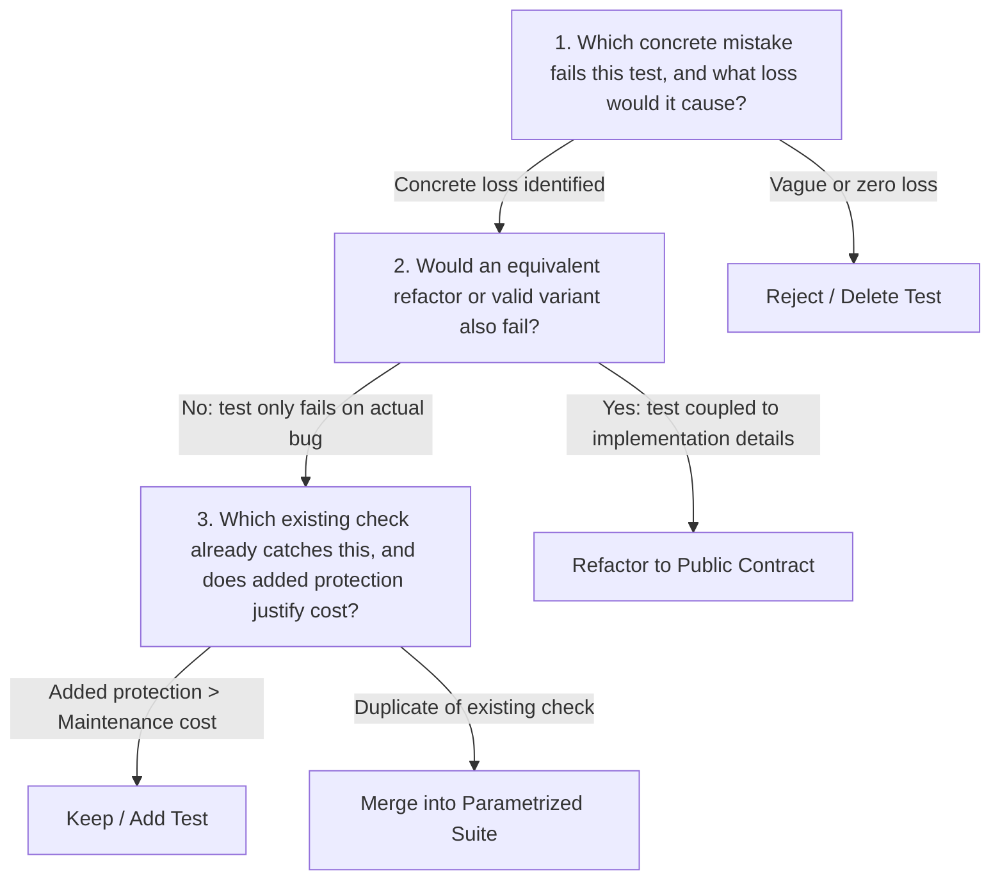

# Test-Value Calculus & Anti-Brittleness Guard

Every test added or maintained in a project carries a continuous maintenance cost. The Test-Value calculus establishes whether that protection is justified.

---

## The Three Questions of Test Value

### 1. Concrete Defect & Consequence
If an agent cannot articulate the exact behavioral failure or regression that would trigger the test failure, the test is decorative slop.

### 2. The Brittle Test Trap
A test is brittle if changing internal structure, renaming private variables, or improving performance breaks the test while leaving the caller's observable behavior unchanged. Tests must assert against public contracts.

### 3. Protection vs. Maintenance Cost
High-consequence boundaries (data integrity, auth/permissions, money/billing, failure recovery) justify dedicated integration tests. Incidental pass-through logic does not.

---

## The Zero-Selection Trap (False Positive Guard)

A pervasive AI agent failure mode:
1. Agent runs `bun test --filter my-new-test` or `pytest -k nonexistent`.
2. Test runner finds 0 matching tests and exits with code 0 (`0 passed, 0 failed`).
3. Agent misinterprets exit code 0 as a passing test suite and claims victory.

**Invariant**: A test command is only evidence of passing behavior if `tests_executed >= 1` and `failed == 0`. An execution with 0 matching tests is a `FAIL` (Zero-Selection Violation).
